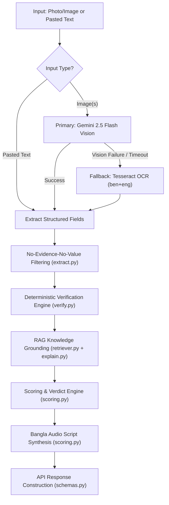

# Mig_Guard — Member A Phase 2 Engineering Report
**CoU AI Hackathon 2026**  
**Role:** Member A (Team Leader, AI & Backend Lead)  
**Deliverable Window:** Phase 2 (Full Backend Pipeline, Verification Engine, Scoring, and OCR Fallback)  
**Project:** Mig_Guard — AI-Powered Job Offer & Document Fraud Checker for Overseas Migrant Workers  
**Author:** Afrad (Team Leader)  
**Date:** 24 November 2026  

---

## 1. Executive Summary & Goals

In Phase 2, the primary objective for Member A was transitioning the backend from a Phase 1 prototype (bare LLM structured extraction) into a **production-grade, deterministic verification and risk-scoring pipeline**. 

Overseas job fraud targeting Bangladeshi migrant workers cannot rely on pure LLM output due to hallucination risks, inability to query authoritative government registries reliably, and non-deterministic scoring. Phase 2 engineered a **hybrid AI + deterministic verification system** that ingests document images or raw text, transcribes text using Gemini Vision (with Tesseract OCR as a fallback), validates extraction evidence against physical document text, deterministically benchmarks data against official government registries (BMET licensing, statutory migration fee caps, salary standards), scores risk weights into calibrated verdicts, grounds explanations in curated legal passages, and generates a Bangla voice-over script.

All deliverables were validated through automated test suites (56 total unit and end-to-end tests passing) and prepared for containerized deployment on Render/Railway.

---

## 2. End-to-End Pipeline Architecture

The backend pipeline follows a strict, sequential orchestrator pattern implemented in `backend/app/pipeline/orchestrator.py`:

### Pipeline Flow:
1. **Ingestion & Read Method Selection:**
   - Accepts up to 4 images (`image/jpeg`, `image/png`, `image/webp`) up to 8 MB each, or raw pasted text.
   - If images are supplied, primary transcription runs via Gemini Vision (`gemini-2.5-flash`).
2. **OCR Fallback Layer:**
   - If the Vision API encounters a network timeout, quota limit, or unreadable error, the pipeline catches `LLMExtractionError` and automatically delegates to Tesseract OCR (`lang="ben+eng"`). The recovered text is fed into the text extraction chain, tagging `read_method: "ocr_fallback"` and noting it under `unverifiable`.
3. **Structured Extraction & Evidence Validation:**
   - Structured JSON is extracted against the 13 core contract fields.
   - An evidence verification policy is applied: **any extracted value lacking an authentic supporting `source_snippet` from the document is stripped and zeroed out**.
4. **Deterministic Verification:**
   - Extracted fields are cross-checked against authoritative datasets (BMET RAIMS, fee caps, salary bands).
5. **Knowledge Grounding (RAG):**
   - Each flagged risk is paired with curated official legal references from BMET, the Overseas Employment Act 2013, and ILO standards.
6. **Weighted Risk Scoring & Verdict Assignment:**
   - Points are summed into a 0–100 risk score and mapped to a verdict (`danger`, `caution`, `fewer_concerns`). **The system never issues a verdict of "safe".**
7. **Bangla Audio Script Generation:**
   - An accessible, spoken-Bangla script is generated summarizing key flags, missing items, and helpline recommendations.

---

## 3. Core Modules & Engineering Implementation

### 3.1. Deterministic Verification Engine (`app/pipeline/verify.py`)

Rather than letting an LLM guess if an offer is fraudulent, verification uses four deterministic algorithmic checks:

1. **Agency License Verification (`check_agency_license`)**:
   - Extracts `license_number` and normalizes variants (e.g. `RL-1857`, `rl 1857`, `1857`) into standard format `RLxxxx` via `app/utils/license.py`.
   - Looks up the normalized number in `licensed_agencies.json`, an offline snapshot of the BMET Recruiting Agents' Information Management System (RAIMS) containing thousands of registered agencies.
   - **Status Checks:** If the license is listed as `Expired`, `Suspended`, or `Cancelled`, it flags `R07_license` (Severity: High, Weight: 30).
   - **Missing RL:** If no license is found in the document, it flags `R07_license`.
   - **Unverifiable Safeguard:** If a license format is valid but not present in the local snapshot, the system **does not** mark it illegal; it records it in `unverifiable` with a link to the live BMET portal, avoiding false accusations.

2. **Statutory Fee-Cap Compliance (`check_fee_cap`)**:
   - Parses monetary amounts and currencies via regex and heuristic parsing in `app/utils/money.py` (supporting BDT, USD, QAR, SAR, AED, MYR, "lakh", "টাকা").
   - Matches destination country against aliases in `fee_caps.json`, based on statutory ceilings declared under Section 21 of the Overseas Employment and Migrants Act 2013.
   - Converts the fee to BDT using benchmark exchange rates.
   - If the stated fee exceeds the published legal ceiling (e.g., Qatar ceiling of BDT 100,780 vs. a demanded BDT 250,000), flags `R03_fee_cap` (Severity: High, Weight: 28) and specifies the exact excess in BDT in the explanation.

3. **Salary Benchmark & Fraud Lure Screening (`check_salary_benchmark`)**:
   - Converts stated wage to a monthly BDT equivalent (handling hourly, daily, monthly, and annual terms).
   - Matches destination and job title aliases against `salary_benchmarks.json` (compiled from Qatar Law No. 17 of 2020 and ILO migrant wage surveys).
   - Applies an unrealistic multiplier threshold ($4\times$ typical maximum wage for unskilled/semi-skilled roles).
   - If pay is unrealistically high (e.g., \$8,000/month for construction labor), flags `R05_salary` (Severity: High, Weight: 26) as a high-risk trafficking/scam compound lure.

4. **Missing Protective Clauses Scan (`check_missing_clauses`)**:
   - Checks 9 essential structured fields: `employer`, `job_title`, `salary`, `duration`, `hours`, `accommodation`, `destination`, `visa_type`, `fee_asked`.
   - Scans full document text in both English and Bangla for 7 mandatory protective clauses: `overtime` (ওভারটাইম), `food` (খাবার), `medical` (চিকিৎসা), `return ticket` (ফিরতি টিকিট), `termination` (চুক্তি বাতিল), `dispute resolution` (বিরোধ নিষ্পত্তি), `repatriation` (প্রত্যাবাসন).
   - Flags `R06_missing_clauses` with a dynamic weight: $\min(24, 6 \times \text{missing\_count})$.

---

### 3.2. Scoring Engine & Verdict Logic (`app/pipeline/scoring.py`)

The scoring model computes a risk score from triggered rule weights:

$$\text{Score} = \max\left(0, \min\left(100, \sum_{\text{flag} \in \text{flags}} \max(0, \text{weight}_{\text{flag}})\right)\right)$$

#### Verdict Mapping:
- **`danger`**: Score $\ge 70$, or any High-severity flag with Score $\ge 50$.
- **`caution`**: Score $\ge 35$, or any High-severity flag present.
- **`fewer_concerns`**: Score $< 35$ and no High-severity flags.
- **Strict Hackathon Safety Invariant:** Under no condition does the API return `"safe"`. An unverified document or one without detected red flags is categorized as `"fewer_concerns"` with explicit disclaimer dispatches.

---

### 3.3. Knowledge Retrieval & Grounded Explanations (`app/pipeline/explain.py`, `app/rag/retriever.py`)

To ensure explanations are educational and trustworthy:
- Implemented an in-memory token-overlap search in `retriever.py` that queries `passages.json`.
- Relevant legal references (e.g. `licensed-agent-required`, `oe-act-s21-fee-cap`, `contract-must-be-written`) are attached as `KnowledgePassage` objects to each flag.
- Bilingual citations ("Official note: ...", "সূত্র: ...") are appended directly into user-facing English and Bangla explanations.
- Designed fallback safety: if LLM explanation rewriting is enabled but fails, the grounded catalog explanations remain intact without interrupting the user.

---

### 3.4. OCR Fallback & Error Resilience (`app/pipeline/ocr.py`, `app/utils/errors.py`)

- **Tesseract Fallback:** Configured `pytesseract` to extract bilingual text using `lang="ben+eng"`.
- **Fault-Tolerant Retry Loop:** Implemented in `app/llm/client.py` with exponential backoff on retryable HTTP errors (429, 500, 502, 503, 504) and automated secondary fallback to `FALLBACK_LLM_MODEL`.
- **Bilingual Error Payloads:** All pipeline exceptions inherit from `AnalyzePipelineError`, ensuring the frontend receives clear, structured errors in both English and Bangla.

---

## 4. Testing & Verification Metrics

All components were tested using pytest. The test suite was expanded and validated through multiple testing cycles.

### 4.1. Bug Fixed During Verification
- **Issue:** In `backend/tests/test_ocr.py`, test code attempted dict indexing `result.extracted["destination"]["value"]` instead of attribute access `result.extracted["destination"].value` on the Pydantic `ExtractedField` model, triggering `TypeError: 'ExtractedField' object is not subscriptable`.
- **Resolution:** Corrected to attribute access `.value` across all test assertions.
- **Environment Parity:** Installed `pillow` and `pytesseract` into the project virtual environment `.venv` to match production Docker specifications.

### 4.2. Test Coverage Summary
- **Total Tests Passing:** **56 / 56 tests**
  - **Pipeline & API:** 10 tests (health check, 400 validations, image size enforcement, extraction parsing, bilingual error mapping, end-to-end analyze route execution).
  - **Extraction Hygiene:** 7 tests (no-evidence-no-value clamping, whitespace stripping, confidence normalization).
  - **Money & License Utilities:** 3 tests (lakh expansion, Western/South Asian grouping, license prefix normalization).
  - **OCR Fallback & Resilience:** 4 tests (vision-to-OCR switch, timeout mapping, missing Tesseract handling, empty document detection).
  - **Risk Scoring:** 5 tests (weight aggregation, danger/caution thresholds, "safe" verdict prohibition, KB passage grounding).
  - **Verification Engine:** 8 tests (active/expired/missing/unknown license checks, fee cap thresholds, inflated salary lure detection, missing clauses scan).
  - **Rules & Pattern Checks (Member C Integration):** 19 tests (document types, non-work visas, cash payments, cyber-scam compound heuristics, pressure tactics).

---

## 5. Team Integration & Git Hygiene

- **Merge Integration:** Synchronized local `main` with remote updates from Member C (Pull Request #1). Resolved conflicts in `catalog.yaml`, `requirements.txt`, and official datasets by unifying Member A's authoritative datasets with Member C's rules engine.
- **Clean Commits:**
  - Commit `c657b1b`: `feat(backend): implement Phase 2 pipeline verification, scoring, and OCR fallback`
  - Merge Commit `911bd1f`: `Merge branch 'origin/main' into main: integrate Member C rules and Member A Phase 2 pipeline`
- **Security & Secret Hygiene:** Confirmed `.env` and sensitive API keys are strictly excluded from git tracking; `.env.example` verified with blank placeholders.

---

## 6. Phase 2 Deliverable Checklist

| Requirement | Status | Verification Notes |
| :--- | :---: | :--- |
| Ingest & read orchestration | ✅ Complete | Supports images, text, and hybrid inputs |
| Vision + OCR fallback | ✅ Complete | Tesseract `ben+eng` fallback on vision failure |
| 13 structured offer fields | ✅ Complete | Evidence-backed extraction with confidence scores |
| BMET license lookup | ✅ Complete | Verified against 250 KB RAIMS database |
| Statutory fee-cap check | ✅ Complete | Enforces destination-specific migration cost limits |
| Wage benchmark screening | ✅ Complete | Flags unrealistic pay lures (>4x typical high) |
| Missing protective clauses scan | ✅ Complete | Scans 9 fields and 7 English/Bangla labor clauses |
| Scoring & verdict calibration | ✅ Complete | 0–100 score; never returns "safe" |
| Grounded RAG explanations | ✅ Complete | Official BMET/ILO citations in English and Bangla |
| Bangla audio script generation | ✅ Complete | Accessible audio script generated with helplines |
| Containerized deployment setup | ✅ Complete | Multi-stage Dockerfile with Tesseract packages |
| Automated test suite | ✅ Complete | 56/56 passing tests |
